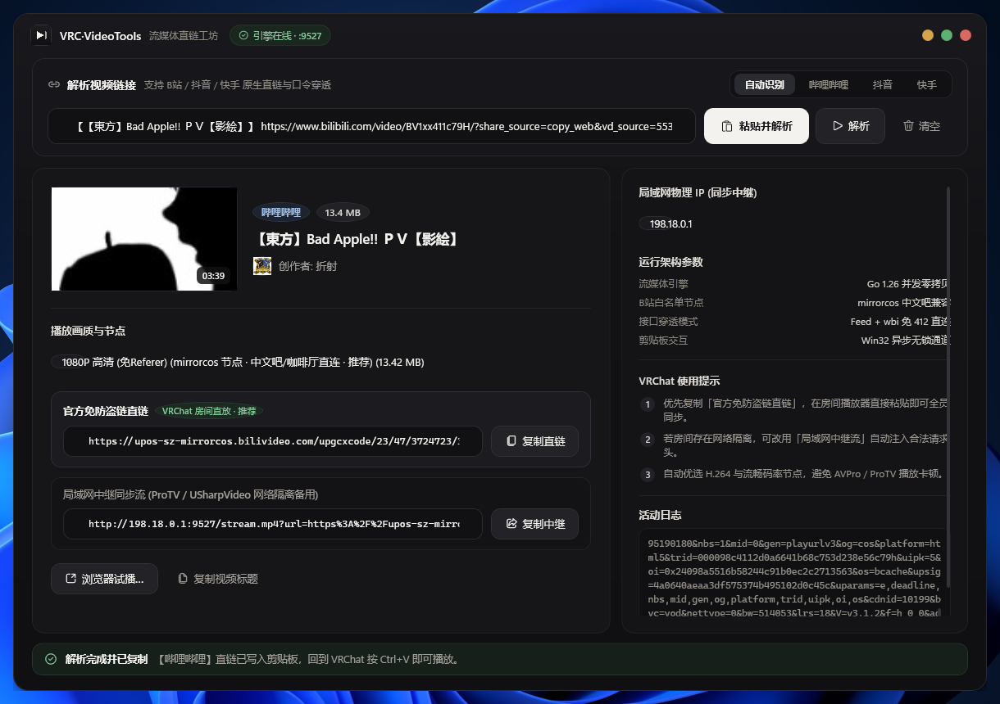

#  VRC-VideoTools

面向 VRChat 播放器环境的多平台视频直链提取工具与局域网流媒体中继服务。项目采用 Go 语言实现并发解析与 HTTP Range 流式代理后端，配合基于 .NET 9 WPF 的无边框桌面客户端及独立单文件安装程序。

---



---

## 核心架构与特性

### 1. Go 并发解析与零拷贝流媒体引擎 (`go-core`)
- **单端口集成服务**：REST API（`/api/parse`、`/api/status`、`/api/ping`）与流媒体转发节点（`/stream.mp4`）统一监听本地 `9527` 端口。
- **HTTP Range 流式转发**：支持 `206 Partial Content` 分片请求与 `io.CopyBuffer` 转发，适配 VRChat 内置 AVPro / ProTV / USharpVideo 播放器的进度拖拽与缓存机制。
- **平台解析策略**：
  - **哔哩哔哩 (Bilibili)**：通过 `wbi/view` 接口绕过常规接口的 412 风控拦截，提取 `html5` MP4 混流后重映射至 `upos-sz-mirrorcos.bilivideo.com`（注入 `build=7330300` 与 `orderid=0,3` 参数），优先适配特定房间播放器白名单规则。
  - **抖音 (Douyin)**：优先调用移动端 `aweme/v1/feed` 接口获取元数据，并通过拦截 `302 Location`（`ErrUseLastResponse`）并发获取 720P、540P 与原画冷流地址，不预先下载视频本体，降低响应延迟并避免单视频体积过大引发播放卡顿。
  - **快手 (Kuaishou)**：支持短链重定向追踪及 GraphQL 作品直链提取。
  - **未知链接容错**：当正则表达式未命中明确平台特征时，通过 goroutine 并发探测三平台解析器，取最先返回的有效结果，避免串行超时叠加。

### 2. 桌面客户端与通信优化 (`wpf-app`)
- **无锁异步剪贴板通道 (`NativeClipboard`)**：弃用 WPF 自带的 OLE 剪贴板包装（避免 `OleFlushClipboard` 在游戏进程全屏或占锁时触发长达 30 秒的跨进程 COM RPC 卡死），直接通过 `user32.dll` 原生 Win32 API 在工作线程异步完成剪贴板读写，耗时控制在毫秒级。
- **本地回环零代理通信 (`ApiClient`)**：显式配置 `SocketsHttpHandler` 的 `UseProxy = false` 与 `Proxy = null`，防止开启系统代理或科学上网工具时 `.NET HttpClient` 访问 `127.0.0.1` 触发 WinINet WPAD 探测导致的数秒阻塞。
- **自定义无边框界面**：移除 Win11 Fluent / Mica 默认窗体框体与高饱和配色，采用低对比干扰的暖深色系、圆角输入栏、自定义滚动条与悬浮状态提示条；支持一键【粘贴并解析】并在提取完成后自动写入系统剪贴板。

### 3. 单文件交互式安装程序 (`installer`)
- 内置离线压缩载荷 `payload.zip`，无需外部附带文件即可独立部署。
- 安装前自动扫描注册表与运行时目录，若检测到缺失 `.NET 9 WindowsDesktop Runtime`，支持自动下载并静默安装运行库。
- 支持自定义安装路径、创建桌面与开始菜单快捷方式，以及配置 `TCP 9527` 端口的 Windows 防火墙入站规则。

---

## 目录结构

```text
.
├── assets/                     # 统一源图标资源 (app.ico, app_logo.png)
├── go-core/                    # Go 核心解析与代理引擎源码
│   ├── api/                    # HTTP REST 路由处理
│   ├── parsers/                # Bilibili / Douyin / Kuaishou 解析实现与统一调度
│   ├── proxy/                  # 零拷贝 Range 流媒体转发服务
│   ├── go.mod
│   └── main.go                 # 服务入口与命令行 -parse 调试模式
├── wpf-app/                    # .NET 9 WPF 桌面客户端工程
│   ├── Assets/                 # 构建时同步的图标资源
│   ├── Models/                 # API 响应数据模型
│   ├── Services/               # ApiClient、CoreProcessManager 与 NativeClipboard
│   ├── MainWindow.xaml         # 无边框自定义界面布局与控件模板
│   └── MainWindow.xaml.cs
├── installer/                  # .NET 9 单文件安装向导工程
│   ├── Assets/
│   ├── Resources/              # 打包阶段生成并内嵌的 payload.zip
│   ├── MainWindow.xaml
│   └── MainWindow.xaml.cs
├── legacy-python/              # 早期 v1.x Python 原型归档源码
├── build.ps1                   # 全自动构建与单文件打包脚本
├── LICENSE                     # MIT 开源许可证
├── README.md                   # 项目说明与更新日志
└── .gitignore
```

---

## 编译与打包

### 环境依赖
- **Go**: 1.26 或更高版本
- **.NET SDK**: .NET 9.0 SDK (`win-x64`)
- **PowerShell**: PowerShell 7 (`pwsh`) 或 Windows PowerShell

### 构建步骤
在仓库根目录运行构建脚本：

```powershell
pwsh -ExecutionPolicy Bypass -File .\build.ps1
```

脚本将依次执行以下操作：
1. 同步 `assets/` 下的图标资源至客户端与安装程序工程目录。
2. 以 `CGO_ENABLED=0` 编译精简体积的 Go 核心二进制 `go-core/vrc-video-core.exe`。
3. 发布桌面端至 `dist/app/` 并打包生成 `installer/Resources/payload.zip`。
4. 发布自包含单文件安装程序 `VRC-VideoTools-Setup.exe`。

---

## 使用说明

1. **常规直链播放（推荐）**
   - 复制 B站、抖音或快手分享链接（或带文案的分享口令）。
   - 点击主界面【粘贴并解析】，程序将自动提取直链并将结果写入系统剪贴板。
   - 切回 VRChat 视频播放器直接按 `Ctrl + V` 粘贴播放即可，同房间所有玩家均可直接拉流观看。
2. **局域网中继模式（备选）**
   - 若目标房间播放器因网络环境或防盗链校验无法直接播放直链，可复制下方的【局域网中继同步流】地址（需保证本地局域网 IP 对联机端可达且 `9527` 端口防火墙规则已放行）。

---

## 更新日志

### v2.2.0 (2026-11-20)
- **界面重构**：移除 Win11 `FluentWindow` / `Mica` 默认窗体框架，切换为自定义无边框暗黑圆角工作台界面（重构输入框、下拉菜单、滚动条与悬浮状态提示条控件模板）。
- **图标重绘**：将原卡通风格图标替换为高对比度极简几何播放与中继标识（512px PNG 与多分辨率 Windows ICO），并统一归口至 `assets/` 目录管理。
- **结构与文档整理**：将遗留的 v1.x Python 源码统一迁移归档至 `legacy-python/` 目录；重写项目说明文档与版本记录。

### v2.1.0 (2026-10-30)
- **交互规范化**：参照桌面人机交互准则调整控件热区、对比度、分段平台选择器及创作者头像展示，修复快速连点复制按钮时的状态回退竞态问题。
- **卡顿死锁修复**：新增 `NativeClipboard` 模块，改用 Win32 原生 API 在工作线程异步读写剪贴板，消除游戏全屏运行期间 WPF `OleFlushClipboard` 引发的 30 秒跨进程 COM RPC 无响应假死。
- **B站接口风控适配**：元数据接口切换为 `x/web-interface/wbi/view` 解决 HTTP 412 拦截；修复 `DetectPlatform` 将含 `av` 字符的文本误判为 B站的问题；将未知平台回退探测改为 goroutine 并发竞争。

### v2.0.1 (2026-10-25)
- **B站节点白名单修复**：将首选及默认输出链接锁定为 `https://upos-sz-mirrorcos.bilivideo.com/` 并注入 `build=7330300` 与 `orderid=0,3`，解决部分 VRChat 中文房间无法播放的问题。
- **响应延迟优化**：为 `ApiClient` 显式禁用系统代理探测（`UseProxy = false`），消除本地回环请求的 WPAD 延迟；抖音冷流解析改用 302 Location 并发拦截以替代流下载；客户端启动时自动清理残留的旧内核进程。

### v2.0.0 (2026-10-05)
- **架构重写**：由原 Python 界面与服务整体迁移至 Go 流媒体核心 + .NET 9 WPF 桌面客户端。
- **独立安装向导**：新增自包含单文件安装器，支持 `.NET 9` 运行时自动检测安装、快捷方式创建与 `9527` 端口防火墙放行。
- **直链与分辨率优化**：抖音默认优先提取 720P 适中码率直链，降低高码率视频在播放器中的缓冲压力。

### v1.0.0 (2026-10-02)
- 初始 Python 原型实现，提供 Bilibili、Douyin、Kuaishou 视频链接解析与本地 HTTP 中继代理功能。

---

## 开源协议

本项目基于 [MIT License](LICENSE) 开源发布。
